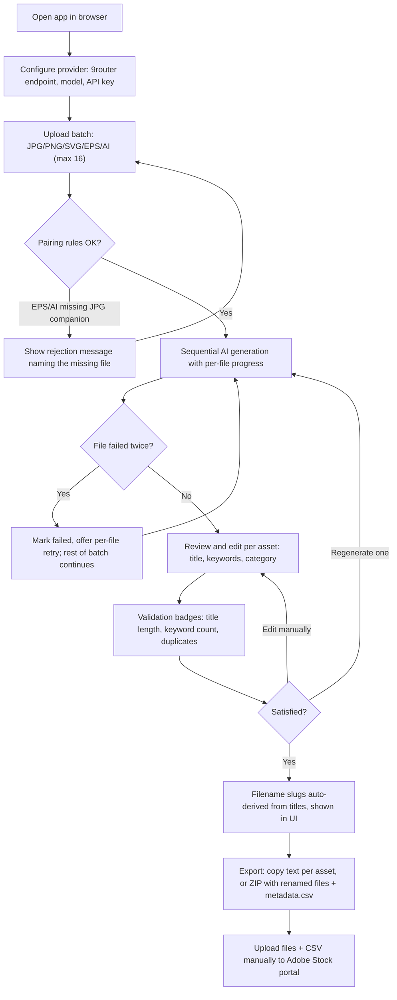
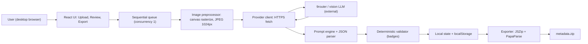

# Stock Metadata Studio PRD

## 1. Overview

### Layer 1: Human PRD

| Field | Content |
|-------|---------|
| Problem Statement | Alviana, an Adobe Stock contributor (1100 assets, niche: black-and-white food line-art vectors), spends excessive manual effort writing titles and keywords for every upload batch (up to 16 assets/day). His existing tool (Stock AI Master v4.0) generates metadata via a hardcoded Gemini endpoint, but its prompt places style keywords in weak positions, forces 30-40 keywords (encouraging filler), has no compound-term protection, and cannot switch providers without code changes. |
| Proposed Solution | Rebuild the tool as **Stock Metadata Studio v5.0**: a local, client-side-only React web app that batch-generates Adobe Stock metadata through a user-configurable vision-LLM provider (9router default). It ships a niche-aware prompt engine (style keywords in top 10, 15-35 accurate keywords, compound terms preserved), deterministic validation badges, sequential processing with per-file retry, automatic filename slugging from titles, and Adobe-format `metadata.csv` + ZIP export. |
| Target Users | Single operator: the owner. Desktop browser, technically comfortable, Indonesian speaker. No multi-user, no accounts, no roles. |
| Scope and exclusions | **MVP scope:** batch upload (JPG/PNG/SVG/EPS/AI) with pairing rules; configurable provider; niche-aware generation; per-asset review/edit; validation badges; per-asset regenerate; auto filename slug; copy-text + ZIP/CSV export. **Explicit exclusions:** no backend/server; no database (localStorage only); no browser extension / direct Adobe portal autofill; no audit mode for old assets; no keyword library manager; no social-caption / market-appeal outputs; no multi-niche prompt presets (one built-in preset: Black-and-White Food Line Art). |
| Decisions and assumptions | See DECISIONS.md for the full log. Key resolved decisions: (1) Web app, local, client-side only — no backend. (2) AI via 9router with configurable endpoint/model/key so the provider can change without code edits. (3) EPS/AI uploads require a same-basename JPG companion; SVG/JPG/PNG are standalone. (4) Fresh build from this PRD; v4.0 is a behavioral reference only, its code is not reused. (5) UI language: Indonesian. (6) MVP first; extension and audit mode deferred to v2. |
| Research basis | Adobe Stock vector requirements (AI/EPS/SVG accepted; SVG suited to icons — helpx.adobe.com, verified 2026-10-07). Adobe keyword guidance synthesized from contributor docs and a 10-asset metadata audit (2026-10-07): keywords 1-10 carry the most weight; 15-35 accurate keywords beat forced maximums; style/medium terms belong in the top 10 for art-style niches. **UNVERIFIED:** 9router's exact API format, vision-model availability, pricing, and rate limits — the builder must confirm against 9router docs at build time and the provider client must tolerate an OpenAI-compatible chat-completions shape. |

### Goals & Success Metrics

| Goal | Metric | Target Value | Measurement Method |
|------|--------|--------------|--------------------|
| Reduce per-batch metadata effort | Wall-clock time for 16 assets, upload to exported ZIP | Under 30 minutes (vs ~2 hours manual) | Owner stopwatch on first 3 real batches |
| Metadata quality meets audit rules | Share of generated assets passing all validation badges without manual keyword edits | >= 70% | Count in-app over 2 weeks of use |
| Provider flexibility | Switch provider/model without code changes | Config-only change, under 2 minutes | Manual test: change model field, regenerate one asset |

### Layer 2: Machine Spec

| Constraint | Value |
|------------|-------|
| Product Type | app (single-page, client-side only) |
| Primary Platform | web (desktop browser) |
| Deployment Target | local only: `npm run dev` or static `vite build` output served locally (e.g. `npx serve`). No hosting, no backend. |
| Data Sensitivity | private: API key in browser localStorage; never written to exports |

### Change Contract (v4.0 → v5.0 rework)

**Current behavior (evidence: owner-supplied v4.0 React source, reviewed 2026-10-07; not executed):** batch upload of JPG/PNG/SVG/EPS/AI; EPS/AI paired with same-basename JPG preview; preview compressed to 1024px JPEG and sent to a hardcoded Gemini vision endpoint/model; tiered-SEO prompt returning title, keywords, category, market_appeal, social_caption; per-asset edit; per-asset regenerate; ZIP export with title-slugged filenames + `metadata.csv`; all files processed in parallel via `Promise.all`; API key entered in-app and held client-side.

**Requested change:** make the AI provider configurable (endpoint + model + key, 9router default); replace the prompt with a niche-aware engine and a corrected output contract; add deterministic validation badges; process files sequentially with per-file retry; formalize upload pairing rules (EPS/AI require JPG; SVG standalone); make filename slugs live-update from titles; remove market_appeal/social_caption outputs. Covered by FR-001..FR-011, NFR-001..NFR-004 below.

**Preserved behavior:** batch upload UX; EPS/AI+JPG pairing concept; per-asset review/edit before export; ZIP + `metadata.csv` export format; the 21 official Adobe Stock category IDs.

**Delta table**

| ID | Status | Note |
|---|---|---|
| FR-001 | unchanged | Batch upload of JPG/PNG/SVG/EPS/AI |
| FR-002 | modified | Pairing rules formalized: EPS/AI require same-basename JPG; SVG/JPG/PNG standalone |
| FR-003 | added | Configurable AI provider (endpoint, model, key); replaces hardcoded Gemini |
| FR-004 | modified | Sequential queue with per-file retry; replaces parallel Promise.all |
| FR-005 | modified | Niche-aware prompt engine + corrected JSON output contract |
| FR-006 | unchanged | Per-asset review and edit |
| FR-007 | added | Deterministic validation badges (were visual-only hints) |
| FR-008 | unchanged | Per-asset regenerate |
| FR-009 | modified | Filename slug now live-updates from title and is displayed; was export-time only |
| FR-010 | unchanged | Copy-text + ZIP/CSV export |
| FR-011 | removed | Retired: market_appeal and social_caption outputs; ID not reused |

**Verification:** checks for each changed/added requirement are in the AC table; preserved behavior (FR-001, FR-006, FR-008, FR-010, category IDs) is re-verified in Milestone 3 regression.

## 2. Requirements

### Review Focus

N/A - no unresolved owner decision. One UNVERIFIED item: 9router API shape (see Research basis); the provider client must be written against the documented OpenAI-compatible chat-completions shape and confirmed at build time.

### Functional Requirements

| ID | Requirement | Priority | Rationale | Acceptance Criteria IDs |
|---|---|---|---|---|
| FR-001 | Batch upload via drag-drop and file picker: JPG/JPEG/PNG/SVG/EPS/AI, up to 16 files per batch | Must | Core input path; matches owner's daily batch size | AC-001, AC-002 |
| FR-002 | Enforce pairing rules: EPS/AI require a same-basename JPG companion; SVG/JPG/PNG are standalone; non-conforming files are rejected with a specific message | Must | Browsers cannot render EPS; JPG is needed for preview and AI analysis; SVG renders natively | AC-003, AC-004 |
| FR-003 | Configurable AI provider: endpoint URL, model name, API key fields, persisted in localStorage, with a test-connection button | Must | Provider flexibility without code changes; no assistant-token spend | AC-005, AC-006 |
| FR-004 | Sequential processing queue (concurrency 1) with per-file progress, max 2 retries per file, and batch continuation when one file fails | Must | Avoids rate limits of parallel calls; one bad file must not kill the batch | AC-007, AC-008 |
| FR-005 | Niche-aware metadata generation returning structured JSON: title, keywords[] (ordered), category_id, confidence, warnings; prompt encodes the Black-and-White Food Line Art rules | Must | The quality differentiator: style keywords in top 10, 15-35 keywords, compounds preserved, no singular/plural duplicates | AC-009, AC-010, AC-011, AC-012 |
| FR-006 | Per-asset review and edit: title text, keyword add/remove/reorder, category dropdown of the 21 official Adobe Stock IDs | Must | Human-in-the-loop before export; AI output is a draft | AC-013 |
| FR-007 | Deterministic validation badges per asset: title length (warn >70, error >200 chars), keyword count (warn outside 15-35), duplicate detection incl. singular/plural, weak-word list | Must | Catches the exact failure modes found in the 10-asset audit | AC-014 |
| FR-008 | Regenerate metadata for a single asset without reprocessing the batch | Should | Cheap recovery from bad AI output | AC-015 |
| FR-009 | Automatic filename slug derived from title, live-updating on every title edit, displayed in the UI; EPS+JPG pairs share the basename; slug used in ZIP and CSV | Must | CSV rows must match uploaded filenames exactly or metadata will not attach | AC-013, AC-016 |
| FR-010 | Export: (a) copy-ready text per asset, (b) ZIP containing renamed files + metadata.csv with columns Filename, Title, Keywords, Category | Must | Handoff to the Adobe Stock portal (manual upload + CSV import) | AC-017, AC-018 |
| FR-011 | AI output contract contains no market_appeal or social_caption fields | Must | Retired v4.0 outputs that do not affect Adobe Stock performance | AC-019 |

### Non-Functional Requirements

| ID | Category | Requirement | Target | Acceptance Criteria IDs |
|---|---|---|---|---|
| NFR-001 | Architecture | Client-side only: no backend, no database; runs from `npm run dev` or a local static build | Zero server processes | AC-021 |
| NFR-002 | Security | API key lives in browser localStorage only; never appears in ZIP, CSV, console logs, or error messages | No secret leakage in any export | AC-020 |
| NFR-003 | Reliability | Provider request timeout 60s; max 2 retries with backoff; clear, actionable error messages (auth failure, timeout, bad response) | No silent failures | AC-006, AC-008 |
| NFR-004 | Usability | Indonesian UI; usable by a single non-expert operator; every destructive or blocking state explains the next action | No dead ends | AC-003, AC-008 |

### Conditional Reliability Contracts

| Contract | Required Detail | Acceptance Evidence or N/A |
|---|---|---|
| Provider unavailability | Generation disabled with message when test-connection fails; queued assets keep their state | AC-006 |
| Partial batch failure | Failed assets marked individually; completed assets unaffected and exportable | AC-008 |
| Secrets handling | NFR-002 | AC-020 |
| Polling/monitoring/retention | N/A - no polling, no background jobs, no server-side retention; localStorage holds provider config and optional draft metadata only | Specific N/A reason: single-user local tool |

### Acceptance Criteria

| ID | Requirement IDs | Type | Observable Criterion | Required Evidence |
|---|---|---|---|---|
| AC-001 | FR-001 | Positive | WHEN 16 mixed files (JPG, SVG, EPS+JPG companions) are dropped, THE SYSTEM SHALL accept all 16 into the queue | Manual test receipt |
| AC-002 | FR-001 | Boundary | WHEN a 17th file is added, THE SYSTEM SHALL reject it with a message and keep the first 16 | Manual test receipt |
| AC-003 | FR-002, NFR-004 | Negative | WHEN an EPS is uploaded without a same-basename JPG, THE SYSTEM SHALL reject it with a message naming the missing companion file | Manual test receipt |
| AC-004 | FR-002 | Positive | WHEN a single SVG is uploaded, THE SYSTEM SHALL accept it and render its preview natively | Manual test receipt |
| AC-005 | FR-003 | Positive | WHEN valid 9router credentials are saved and Test is pressed, THE SYSTEM SHALL report success | Manual test receipt |
| AC-006 | FR-003, NFR-003 | Negative | WHEN the API key is wrong, THE SYSTEM SHALL show an authentication error within 60s and offer to edit settings | Manual test receipt |
| AC-007 | FR-004 | Positive | WHEN 4 files are processed, THE SYSTEM SHALL process them strictly one after another with per-file progress shown | Manual test receipt |
| AC-008 | FR-004, NFR-003, NFR-004 | Negative | WHEN one file fails twice, THE SYSTEM SHALL mark it failed with a per-file retry button while the other files complete and remain exportable | Manual test receipt |
| AC-009 | FR-005 | Positive | WHEN generation succeeds, THE SYSTEM SHALL return valid JSON containing title, keywords array, category_id, confidence, and warnings | Manual test receipt |
| AC-010 | FR-005 | Positive | WHEN the input is black-and-white food line art, THE SYSTEM SHALL place style terms (e.g. "line art", "black and white") within the first 10 keywords | Manual test on 3 samples |
| AC-011 | FR-005 | Boundary | WHEN generation succeeds, THE SYSTEM SHALL return between 15 and 35 keywords | Manual test receipt |
| AC-012 | FR-005 | Negative | WHEN keywords contain singular/plural duplicates (e.g. "banana" and "bananas"), THE SYSTEM SHALL NOT emit both | Manual test receipt |
| AC-013 | FR-006, FR-009 | Positive | WHEN the title is edited, THE SYSTEM SHALL update the derived filename slug live in the asset card | Manual test receipt |
| AC-014 | FR-007 | Boundary | WHEN a title exceeds 200 characters, THE SYSTEM SHALL show an error badge and exclude the asset from export until fixed | Manual test receipt |
| AC-015 | FR-008 | Positive | WHEN regenerate is pressed on one asset, THE SYSTEM SHALL replace only that asset's metadata | Manual test receipt |
| AC-016 | FR-009 | Positive | WHEN an EPS+JPG pair is exported, THE SYSTEM SHALL give both files the same basename slug with their own extensions | ZIP inspection |
| AC-017 | FR-010 | Positive | WHEN export is pressed, THE SYSTEM SHALL produce a ZIP containing the renamed files and metadata.csv whose Filename values match the ZIP entries exactly | ZIP + CSV inspection |
| AC-018 | FR-010 | Positive | THE metadata.csv SHALL have exactly the columns Filename, Title, Keywords, Category with comma-separated keywords | CSV inspection |
| AC-019 | FR-011 | Negative | THE AI output contract SHALL contain no market_appeal or social_caption fields | Code inspection |
| AC-020 | NFR-002 | Negative | THE exported ZIP and CSV SHALL contain no API key or endpoint secrets | ZIP + CSV inspection |
| AC-021 | NFR-001 | Positive | THE app SHALL run from a local static build with no server process beyond a static file server | Run `npx serve dist`, exercise upload-to-export path |

### Constraints

| Constraint | Value |
|------------|-------|
| Runtime | Modern desktop browser (Chrome/Edge/Firefox latest); Node.js 20+ for build/dev only |
| Network | Outbound HTTPS to the configured provider endpoint only; all other operation offline-capable |
| Secrets | Only credential names/stores documented (localStorage key `sms.provider`); values never in code, logs, or exports |
| Batch size | Max 16 files per batch (AC-002) |
| Preview raster | JPEG, max dimension 1024px, quality ~0.85 (matches v4.0 behavior) |
| Duplicate submission | Generate button disabled while the queue is active; re-pressing is a no-op |

## 3. Core Features

### Feature 1: Provider Settings

User-configurable AI provider; the foundation that removes the hardcoded-Gemini limitation (FR-003, NFR-002).

| Item | Specification |
|------|---------------|
| Inputs | Endpoint URL, model name, API key (password field) |
| Outputs | Persisted config in localStorage; test-connection result message |
| Data Dependencies | ProviderConfig model |
| UI Components | Settings panel (first-run prompt if empty); Save + Test Connection buttons |
| Failure Handling | Auth/network/timeout errors shown inline with "edit settings" action; generation buttons disabled until a successful test |

**Acceptance Criteria** (canonical definitions in §2; referenced here, not redefined)

| AC ref | Requirement IDs | Summary |
|---|---|---|
| AC-005 | FR-003 | Connection test succeeds with valid credentials |
| AC-006 | FR-003, NFR-003 | Wrong key shows an authentication error within 60s with an edit action |
| AC-020 | NFR-002 | No secret appears in any export |

### Feature 2: Batch Upload with Pairing Rules

File intake enforcing the EPS/AI-require-JPG and SVG-standalone rules (FR-001, FR-002, NFR-004).

| Item | Specification |
|------|---------------|
| Inputs | Drag-drop zone + file picker; JPG/JPEG/PNG/SVG/EPS/AI; max 16 files |
| Outputs | Validated asset queue; per-file status (ready / rejected with reason) |
| Data Dependencies | Asset model |
| UI Components | Drop zone, file list with status chips, rejection messages |
| Failure Handling | Rejected files listed with specific reasons (missing JPG companion, over batch limit, unsupported type); valid files unaffected |

**Acceptance Criteria** (canonical definitions in §2; referenced here, not redefined)

| AC ref | Requirement IDs | Summary |
|---|---|---|
| AC-001 | FR-001 | 16 mixed valid files are all accepted |
| AC-002 | FR-001 | 17th file rejected with message, first 16 kept |
| AC-003 | FR-002, NFR-004 | EPS without same-basename JPG rejected, message names the missing file |
| AC-004 | FR-002 | Single SVG accepted with native preview |

### Feature 3: Sequential Generation Queue

One-at-a-time AI processing with progress and per-file recovery (FR-004, FR-005, NFR-003).

| Item | Specification |
|------|---------------|
| Inputs | Asset queue; ProviderConfig; niche-aware prompt template |
| Outputs | Per-asset metadata JSON: title, keywords[], category_id, confidence, warnings |
| Data Dependencies | Asset, ProviderConfig |
| UI Components | Queue progress bar, per-file spinner/status, per-file Retry button |
| Failure Handling | Timeout 60s, max 2 retries with backoff; failed file marked individually; batch continues |

**Acceptance Criteria** (canonical definitions in §2; referenced here, not redefined)

| AC ref | Requirement IDs | Summary |
|---|---|---|
| AC-007 | FR-004 | Files process strictly sequentially with per-file progress |
| AC-008 | FR-004, NFR-003, NFR-004 | Double-failed file marked failed with retry; others complete and exportable |
| AC-009 | FR-005 | Valid JSON with title, keywords, category_id, confidence, warnings |
| AC-010 | FR-005 | Style terms in first 10 keywords for B&W food line art (3 samples) |
| AC-011 | FR-005 | 15-35 keywords returned |
| AC-012 | FR-005 | No singular/plural duplicate keywords |
| AC-019 | FR-011 | No market_appeal / social_caption fields in output contract |

**Niche prompt rules (encoded in the prompt template, verified by AC-010..AC-012):**
1. Keywords 1-10 are the highest-weight slots: subject terms first, then style/medium terms ("line art", "black and white", "vector illustration") — never buried at positions 11+.
2. 15-35 keywords, accuracy over count; no filler.
3. Compound terms preserved as single keywords ("line art", "olive oil", "ice cream").
4. No singular/plural duplicates; no banned weak words (configurable list, e.g. "unhealthy" for food).
5. Title: natural phrase, ~70 characters target, hard cap 200; must read like a stock title, not a keyword dump.
6. category_id must be one of the 21 official Adobe Stock category IDs.

### Feature 4: Review, Edit, Validate

Human-in-the-loop editing with deterministic quality badges (FR-006, FR-007, FR-008, FR-009).

| Item | Specification |
|------|---------------|
| Inputs | Generated metadata per asset; user edits |
| Outputs | Finalized per-asset metadata; derived filename slug |
| Data Dependencies | Asset |
| UI Components | Asset cards: preview, editable title, keyword chips (add/remove/reorder), category dropdown, validation badges, regenerate button, derived filename display |
| Failure Handling | Error badge (title >200 chars) excludes the asset from export until fixed, with a clear message |

**Acceptance Criteria** (canonical definitions in §2; referenced here, not redefined)

| AC ref | Requirement IDs | Summary |
|---|---|---|
| AC-013 | FR-006, FR-009 | Title edit live-updates the derived filename slug |
| AC-014 | FR-007 | Title >200 chars shows error badge and blocks that asset's export |
| AC-015 | FR-008 | Regenerate replaces only that asset's metadata |
| AC-016 | FR-009 | EPS+JPG pair shares the basename slug on export |

**Slug rules:** lowercase; spaces/punctuation to hyphens; strip characters illegal in filenames; collapse repeats; trim to 120 characters; EPS+JPG pairs share basename.

### Feature 5: Export

Handoff artifacts for the Adobe Stock portal (FR-010, NFR-002).

| Item | Specification |
|------|---------------|
| Inputs | Finalized assets |
| Outputs | (a) Copy-ready text per asset; (b) ZIP with renamed files + metadata.csv |
| Data Dependencies | Asset |
| UI Components | Export bar: Copy buttons per asset, Export ZIP button, pre-export validation summary |
| Failure Handling | Assets with error badges are excluded from ZIP/CSV and listed; export never silently drops an asset without naming it |

**Acceptance Criteria** (canonical definitions in §2; referenced here, not redefined)

| AC ref | Requirement IDs | Summary |
|---|---|---|
| AC-017 | FR-010 | ZIP filenames match metadata.csv Filename values exactly |
| AC-018 | FR-010 | CSV has exactly Filename, Title, Keywords, Category; keywords comma-separated |
| AC-020 | NFR-002 | No secrets in ZIP or CSV |

## 4. User Flow

### Primary Flow



### Interaction Detail

| Step | Actor | Action | System Response |
|------|-------|--------|-----------------|
| 1 | User | Opens app first time | Settings panel prompts for provider config |
| 2 | User | Saves config, presses Test | Success or actionable error message |
| 3 | User | Drops batch of files | Queue shows ready/rejected per file with reasons |
| 4 | User | Presses Generate | Sequential progress per file; metadata appears per card |
| 5 | User | Edits title/keywords/category | Validation badges update; filename slug updates live |
| 6 | User | Presses Export ZIP | ZIP downloads; excluded error-badge assets are named |

### Edge Cases

| Edge Case | Handling | User Feedback |
|-----------|----------|---------------|
| Provider endpoint unreachable | Generation disabled; config retained | "Cannot reach provider. Check endpoint or network." + edit action |
| AI returns malformed JSON | Counts as a failed attempt; retry | "Bad response from model, retrying (1/2)" |
| All files rejected at upload | Empty queue state | "No valid files. EPS/AI need a same-name JPG." |
| SVG with external references | Rasterize may miss externals; preview shows what was rendered | Warning badge on the asset if raster is blank |
| User closes tab mid-batch | Queue state lost (no persistence of in-flight batch) | N/A - documented limitation; provider config persists |

## 5. Architecture

### System Diagram



No backend, no database, no auth service. The only external dependency is the configured LLM provider over HTTPS.

### Tech Stack

| Layer | Technology | Version | Rationale | Verification |
|-------|------------|---------|-----------|--------------|
| UI framework | React | 18 | Existing v4.0 codebase is React; zero rewrite | Owner-supplied source, 2026-10-07 |
| Build/dev | Vite | latest stable at build time | Standard React tooling; static build for local use | UNVERIFIED - builder confirms |
| Styling | Tailwind CSS | v4 (or latest stable) | v4.0 UI already uses Tailwind classes | Owner-supplied source, 2026-10-07 |
| ZIP export | JSZip | latest stable | Already used in v4.0 | Owner-supplied source, 2026-10-07 |
| CSV export | PapaParse | latest stable | Already used in v4.0 | Owner-supplied source, 2026-10-07 |
| Icons | lucide-react | latest stable | Already used in v4.0 | Owner-supplied source, 2026-10-07 |
| AI provider | 9router (configurable) | N/A | Owner's chosen router; endpoint/model/key are config, not code | UNVERIFIED - builder checks 9router docs for API shape, vision support, pricing |

### Builder Capability Routing Contract

Act on the current request: a PRD alone does not authorize building. At startup,
read this PRD and target instructions once; inspect the host-provided available
skill/tool catalog, read matching instructions, and check prerequisites.
Record chosen routes, UNAVAILABLE preferences, affected IDs, and evidence limits
in PROGRESS.md and the audit. Names do not authorize installation or host/model
changes; use declared repository-native fallbacks.

For new native builds, the explicit build request authorizes scoped local work.
Use this PRD's outcome milestones and coverage in PROGRESS.md; show the plan and
continue without another routine approval. Make the core path runnable early,
complete the requested scope and visual quality, and preserve unrelated work.
Set status to implementation at build start; advance current_milestone only
after required evidence passes. Component steps stay internal checklists.

Existing toolkit TASKS.json/.prd/task-state.json or an explicit runner request
requires the actual runner and its guide. Preserve exact plan approval and
failure rules; never bypass failure, PLAN_CHANGED, missing runner access, or
state conflicts by switching modes. Native builds need no toolkit installation.

Read relevant changed files on continuation, not the whole project per step.
Keep a concise resume delta in PROGRESS.md: current milestone, changed paths,
checks/results, unresolved IDs, and next action. Recheck affected dependencies
when source, requirements, environment, or route evidence changes. Do not repeat
unchanged discovery, regenerate the PRD, or rerun unrelated suites per file.

Use targeted checks while building; diagnose failures before bounded retries.
Fallbacks never weaken ACs or turn mocks/unperformed manual checks into live
proof. Continue independent safe work, keeping dependent IDs UNVERIFIED.
Pause for blocking decisions, material scope changes, or a genuine new authority boundary: external
writes, destructive actions, purchases, credential changes, deployment, production,
or owner acceptance—not ordinary milestone transitions.

Finish with full applicable regression, the intended user path and material
failure/boundary tests; repair in-scope defects and rerun affected checks.
IMPLEMENTATION_AUDIT.md must cover every FR/NFR/AC: expected behavior, surface,
source-state identity, exact checks/results, real-versus-mocked evidence,
VERIFIED/PARTIAL/NOT_IMPLEMENTED/UNVERIFIED status, and limitations.
Completion requires all implementation-scoped requirements/checks to pass.
After each milestone report outcome, grouped changes, exact trial instructions,
verification, limits, progress, and next action; continue covered work automatically.
Deployment and final owner acceptance are separate claims.

| Trigger | Required capability | Preferred skill/tool if available | Fallback if unavailable | Required evidence | Authority |
|---|---|---|---|---|---|
| Build React+Vite app locally | JS/TS build, npm | Host Node.js 20+ | N/A - required | `npm run dev` serves UI; `npm run build` succeeds | Local allowed |
| Verify provider API shape | Web docs reading | 9router docs | Owner provides docs link or sample response | Documented request/response shape in PROGRESS.md | Local allowed |
| Vision-model smoke test | Authenticated HTTPS call | Owner's 9router key (owner enters it) | Mark FR-005 ACs UNVERIFIED until owner tests | Successful test-connection + one generation | Owner enters key; builder never stores it |
| ZIP/CSV correctness | File inspection | unzip + CSV parse | Manual inspection | AC-017, AC-018 receipts | Local allowed |

## 6. Data Models

### Model Table

| Model | Purpose | Key Fields | Relationships | Indexes |
|-------|---------|------------|---------------|---------|
| Asset | One submitted artwork through the pipeline | id, sourceFiles[] {name, type, size}, kind (raster/svg/eps-pair), previewUrl, status (ready/queued/processing/failed/done), metadata {title, keywords[], categoryId, confidence, warnings[]}, derivedFilename, error | 1:1 with metadata | N/A - in-memory + optional localStorage draft |
| ProviderConfig | AI provider connection | endpoint, model, apiKey | Used by queue | localStorage key `sms.provider` |
| Batch | One upload-to-export session | id, createdAt, assetIds[] | 1:N Asset | N/A - in-memory |

### Validation Rules

| Field/Input | Type | Rule | Error Message |
|-------------|------|------|---------------|
| title | string | 1-200 chars; warn >70 | "Title exceeds 200 characters (Adobe limit)" / "Long title - consider under ~70 characters" |
| keywords | string[] | 15-35 items; warn outside | "Only N keywords - aim for 15-35 accurate ones" |
| keywords | string[] | No case-insensitive duplicates; no singular/plural pairs | "Duplicate: 'X' appears twice" |
| keywords | string[] | Compound terms kept whole | Validated in prompt; spot-check in review |
| categoryId | int | One of the 21 official Adobe Stock IDs | "Select a valid category" |
| derivedFilename | string | Slug rules (Feature 4); unique within batch | "Filename collision - edit a title" |
| endpoint | URL | Valid https URL | "Endpoint must be a valid https URL" |

The 21 Adobe Stock category IDs (1=Animals … 21=Transportation, per v4.0's CATEGORIES list) are preserved unchanged.

## 7. Design System

**Style direction: Neo-brutalism** (owner-approved reference image, 2026-10-07). Thick black borders, hard offset shadows (no blur), flat bright colors, extra-bold headings. Replaces the generic v4.0 slate/indigo aesthetic. Design source priority at build time: (1) the Stitch project "Stock Metadata Studio" (projects/10634292234433338950) via the Stitch MCP tools in OpenCode — its screens and Neo-Brutalist design system instance; (2) a Stitch-exported DESIGN.md in the repo root, if present; (3) the extracted tokens below. Indonesian UI copy.

### Visual Tokens

| Token | Value | CSS Variable |
|-------|-------|--------------|
| Border | 3px solid #111111 | --border-thick |
| Radius | 14px cards / 10px buttons | --radius-card / --radius-btn |
| Hard shadow | 6px 6px 0 #111111 (no blur) | --shadow-hard |
| Hard shadow (small) | 4px 4px 0 #111111 (no blur) | --shadow-hard-sm |
| Background | #FFD21F (vivid yellow) | --color-bg |
| Surface | #FFFFFF | --color-surface |
| Text | #111111 | --color-text |
| Primary action | #FFC800 (bright yellow fill, black border, hard shadow) | --color-primary |
| Accent pink | #FF4D8D | --color-accent-pink |
| Accent purple | #7B61FF | --color-accent-purple |
| Accent green | #2ECC71 | --color-accent-green |
| Danger | #DC2626 (badge fill #FF4D8D for errors on cards) | --color-danger |
| Warning | #D97706 (amber-600) | --color-warning |

Dark mode: N/A - single light neo-brutalist theme; no dual-theme requirement.

### Typography

| Token | Value |
|-------|-------|
| Display/headings | Extra-bold grotesque (e.g. Archivo Black or Inter 800); large sizes, tight leading |
| Body | Semibold system stack: `-apple-system, "Segoe UI", Inter, Roboto, sans-serif` |
| Monospace | UI-monospace stack for filenames and CSV preview |

### Neo-brutalist Component Rules

| Component | Rule |
|-----------|------|
| Cards | White fill, 3px black border, 14px radius, 6px hard shadow |
| Buttons (primary) | Bright yellow fill, 3px black border, 10px radius, 4px hard shadow; on press, shadow collapses (translate 4px, 4px) |
| Buttons (icon) | White fill, 3px black border, hard shadow-sm |
| Input fields | White fill, 3px black border, 10px radius; focus keeps border, no glow |
| Badges/chips | Flat bright fill per severity, 2-3px black border, small radius |
| Status colors | Never color-only: badges always include a text label |

### Interaction States

| State | Requirement |
|-------|-------------|
| Loading | Per-file spinner in queue; skeleton shimmer on asset cards during generation |
| Empty | Drop zone shows "Drop files here or click to browse (JPG, PNG, SVG, EPS/AI + JPG)"; empty queue shows pairing-rule hint |
| Error | Inline red banner with specific cause + next action; error badges on asset cards |
| Disabled | Generate disabled until provider test passes; Export disabled until at least one valid asset |

Accessibility: keyboard-reachable controls, visible focus rings, alt text on previews, sufficient color contrast (badges never color-only; include text labels).

## 8. API Spec

No backend API exists (NFR-001). This section documents the **outbound provider contract** the app must implement.

### Provider Request (OpenAI-compatible chat completions — confirm against 9router docs at build time)

| Item | Value |
|------|-------|
| Method/URL | POST `{endpoint}/chat/completions` |
| Headers | `Authorization: Bearer {apiKey}`, `Content-Type: application/json` |
| Body | `{ model, messages: [{ role: "user", content: [{ type: "text", text: <prompt> }, { type: "image_url", image_url: { url: "data:image/jpeg;base64,..." } }] }], response_format: { type: "json_object" } }` |
| Timeout | 60s (NFR-003) |
| Success | 200 with `choices[0].message.content` containing the metadata JSON |
| Errors | 401 -> auth message; 429/5xx -> retry with backoff (max 2); timeout -> retry; malformed JSON -> failed attempt |

### Metadata JSON Contract (prompt output)

```json
{
  "title": "string, natural phrase, <=200 chars",
  "keywords": ["ordered", "15-35 items", "compounds preserved"],
  "category_id": 11,
  "confidence": 0.0,
  "warnings": ["ambiguous subject detail, if any"]
}
```

No `market_appeal`, no `social_caption` (FR-011).

## 9. File Map

| Path | Purpose | Owner/Layer |
|------|---------|-------------|
| `index.html` | Vite entry | Frontend |
| `src/main.jsx` | React bootstrap | Frontend |
| `src/App.jsx` | Shell: settings, upload, queue, review, export layout | Frontend |
| `src/config/provider.js` | ProviderConfig load/save/test (localStorage) | Frontend/Data |
| `src/lib/upload.js` | File intake, type detection, pairing-rule validation | Frontend |
| `src/lib/preprocess.js` | SVG rasterize via canvas, JPEG 1024px compression | Frontend |
| `src/lib/providerClient.js` | HTTPS client: timeout, retries, error mapping | Frontend |
| `src/lib/prompt.js` | Niche-aware prompt template + JSON contract | Frontend |
| `src/lib/queue.js` | Sequential processing queue with per-file retry | Frontend |
| `src/lib/validate.js` | Deterministic validators -> badges | Frontend |
| `src/lib/slug.js` | Filename slug derivation | Frontend |
| `src/lib/export.js` | JSZip + PapaParse: ZIP and metadata.csv builders | Frontend |
| `src/components/` | AssetCard, QueueBar, SettingsPanel, ExportBar, Badges | Frontend |
| `src/data/categories.js` | 21 Adobe Stock category IDs (preserved from v4.0) | Frontend/Data |

Exact component decomposition is the builder's choice; the table defines responsibility boundaries.

## 10. Milestones

| # | Milestone | Done When | Status |
|---|-----------|-----------|--------|
| 1 | Core path runnable (fresh build) | Upload batch -> configure provider -> sequential generation -> review/edit -> copy-text and ZIP/CSV export works end-to-end in `npm run dev` with a stubbed or real provider; FR-001, FR-003, FR-004, FR-006, FR-008, FR-010 demonstrable | ⬜ Not Started |
| 2 | Quality hardening (the v5.0 differentiators) | Niche-aware prompt engine (FR-005) with AC-010/011/012 passing on 3+ real samples; validation badges (FR-007); pairing rules (FR-002); live filename slugs (FR-009); retired outputs removed (FR-011); all AC-001..AC-021 addressed | ⬜ Not Started |
| 3 | Integrated audit and handoff | Full AC-001..AC-021 verification against the real 9router provider; regression of preserved v4.0 behavior; defects fixed and rerun; IMPLEMENTATION_AUDIT.md complete; owner trial instructions delivered | ⬜ Not Started |

Three milestones: (1) early runnable path, (2) the quality scope that justifies v5.0, (3) integrated audit. Each is an independently meaningful outcome.

### Authority Policy v1

For a new native build, the user's explicit build request authorizes scoped local implementation.

One exact plan approval covers declared local runner transitions.

Pause only for a blocking decision, material scope change, or a genuine new authority boundary: external writes, destructive actions, purchases, credential changes, deployment, production, or owner acceptance.

### Traceability Matrix

| Feature | FR/NFR IDs | AC IDs | Data Model(s) | API/Interface | UI/File Path | Milestone | Required Evidence |
|---|---|---|---|---|---|---|---|
| Provider Settings | FR-003, NFR-002, NFR-003 | AC-005, AC-006, AC-020 | ProviderConfig | Provider request | SettingsPanel, src/config/provider.js | 1 | Manual test receipt |
| Batch Upload | FR-001, FR-002, NFR-004 | AC-001, AC-002, AC-003, AC-004 | Asset | Local file input only - no API | Drop zone, src/lib/upload.js | 1 | Manual test receipt |
| Generation Queue | FR-004, FR-005, FR-011, NFR-003 | AC-007, AC-008, AC-009, AC-010, AC-011, AC-012, AC-019 | Asset, ProviderConfig | Provider request | QueueBar, src/lib/queue.js, src/lib/prompt.js | 1, 2 | Manual test receipt |
| Review/Edit/Validate | FR-006, FR-007, FR-008, FR-009 | AC-013, AC-014, AC-015, AC-016 | Asset | Local UI only - no API | AssetCard, src/lib/validate.js, src/lib/slug.js | 1, 2 | Manual test receipt |
| Export | FR-010, NFR-002 | AC-017, AC-018, AC-020 | Asset | Local file generation - no API | ExportBar, src/lib/export.js | 1 | ZIP + CSV inspection |
| Local-only architecture | NFR-001 | AC-021 | No persistent models - localStorage only | No API - static client app | Build config | 1 | Static-serve run receipt |

### Verification Receipt and Operator Handoff

| Field | Required Value |
|---|---|
| Proven claim/status | PRD drafted and structurally validated; NOT implemented, NOT tested |
| Source state | `~/workspace/adobe-stock-metadata-app/PRD.md` v0.1.0 |
| Environment | PRD authoring only; no runtime exercised |
| Procedure and result | `node scripts/validate-prd.mjs PRD.md --json` (see validation result below); checklist self-review per PRD_VALIDATION_CHECKLIST.md |
| Side effects and cleanup | None - specification only |
| Readiness and limitations | Ready for builder handoff. 9router API shape UNVERIFIED - builder must confirm. No implementation evidence exists. |
| One next action | In the target project, give a fresh builder this PRD.md and say "Build this PRD until done." |
